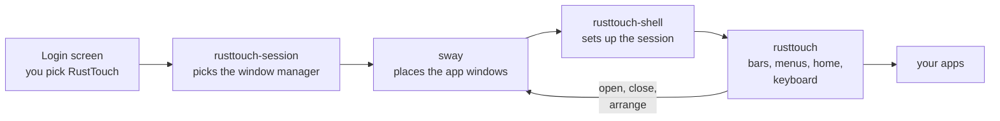
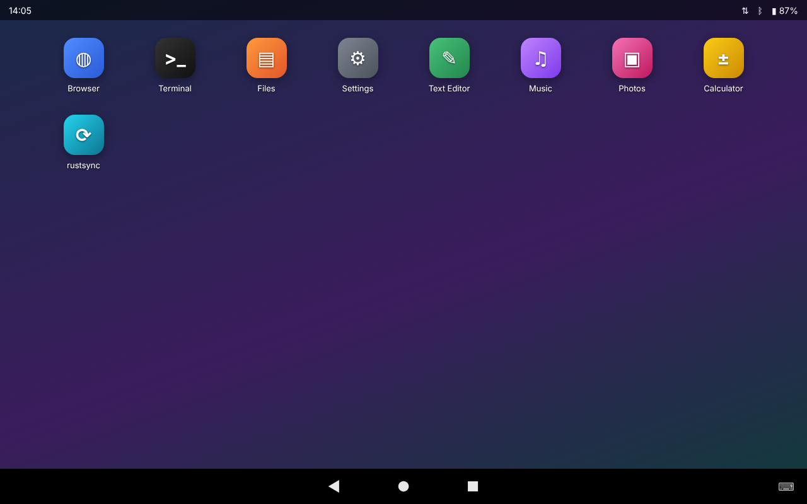
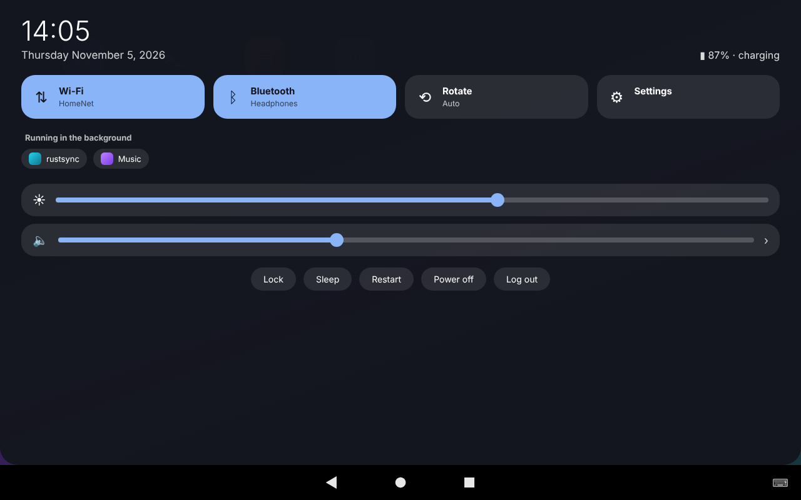
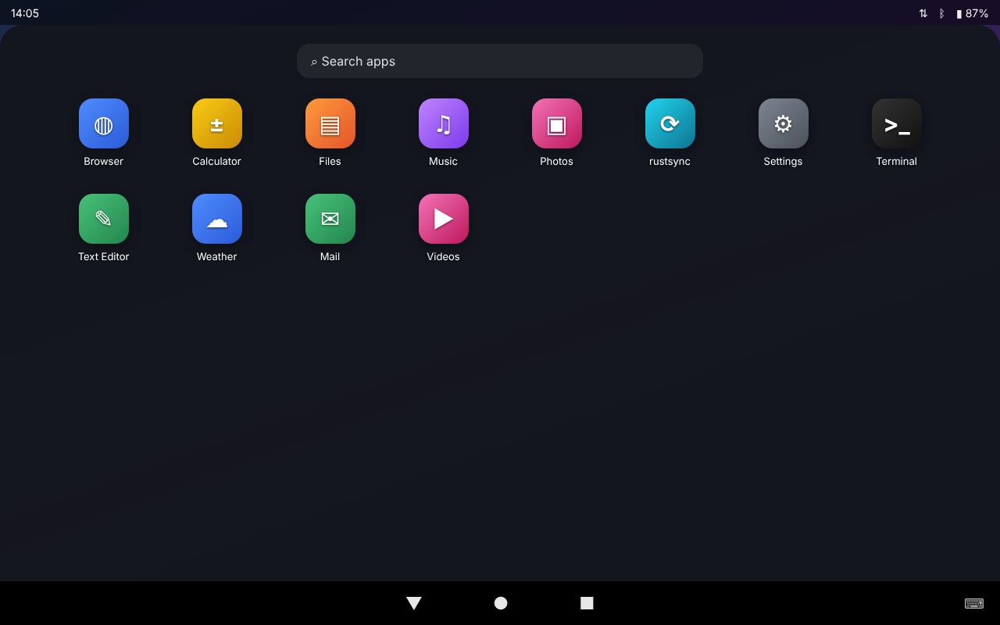
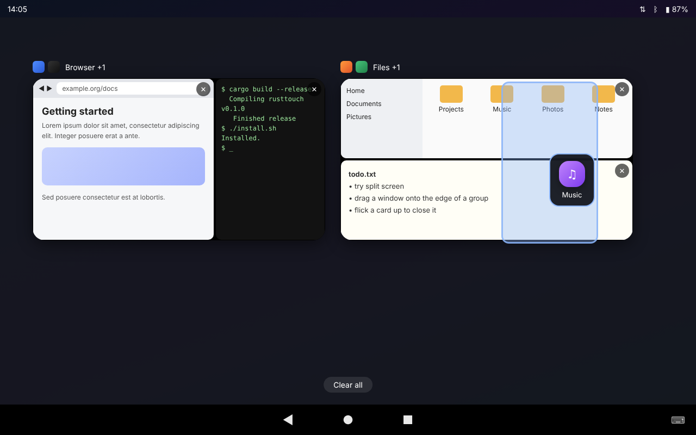
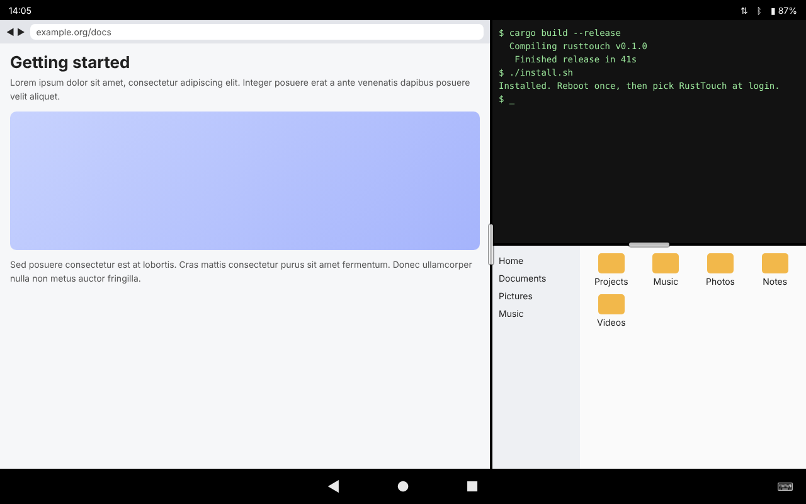
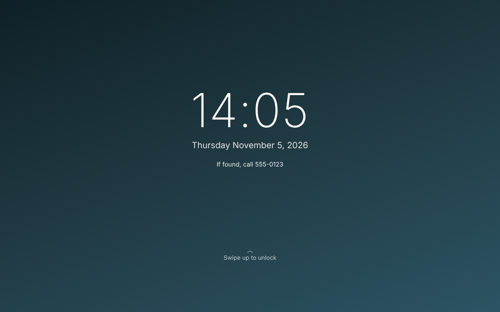

<p align="center"></p>

# !!!VIBE CODED CLANKER CODE!!!

# RustTouch

**A simple, Android-style touch desktop for Linux tablets and touch-screen laptops.** Swipe up
for your apps, swipe down for Wi-Fi, Bluetooth and the clock, and use the familiar ◀ ● ■ buttons
at the bottom. Put two or more apps side by side when you need to.

> **Please read this first.** This project was written almost entirely by an AI assistant and has
> had very little human review or real-world testing. It is a hobby project. Keep your usual
> desktop installed as well: RustTouch is just another choice on the login screen, and you can
> always log out and pick your usual one.

- **Familiar.** If you've used an Android phone or tablet, you already know how it works: the
  home screen, the app drawer, the pull-down menu, and back, home and recent apps.
- **Made for fingers.** Its own on-screen keyboard that opens when you tap a text box, big
  touch targets, hold-to-repeat volume and brightness buttons, and the screen turns with you.
- **Apps side by side.** Drag one app onto another in recent apps to split the screen. Apps that
  share the screen move around together as one card, a *window group*.
- **Small.** A couple of programs written in Rust with GTK 4, on top of the sway window manager.
  One settings app, and one text file holding all the settings.

Contents: [How it works](#how-it-works-in-one-minute) · [Pictures](#pictures) ·
[Install](#install) · [How to use it](#how-to-use-it) · [Apps side by side](#apps-side-by-side) ·
[Settings](#settings) · [Building and releasing](#building-and-releasing) ·
[Security](#security) · [Troubleshooting](#troubleshooting)

---

## How it works in one minute

Six words are all you need:

| Word | What it means |
|---|---|
| **Home screen** | Your app icons on your background. Press and hold an icon to move or remove it. |
| **App drawer** | Every app you have. Swipe up from the bottom to open it, and type to search. |
| **Pull-down menu** | Swipe down from the top: Wi-Fi, Bluetooth, screen rotation, brightness, volume, the clock and battery, and lock, sleep and power off. |
| **Button bar** | ◀ back, ● home and ■ recent apps at the bottom, with ⌨ for the keyboard on the right. |
| **Recent apps** | ■ shows a card for each open app, with a picture of it. Tap one to go back to it, flick it up to close it. |
| **Window group** | Apps sharing the screen. They show as one card in recent apps, and you swipe between groups along the button bar. |

```
 ┌──────────────────────────────┐
 │ 12:30           Wi-Fi ▾ 87%  │ ← top bar: swipe down for the pull-down menu
 │                              │
 │   ▢    ▢    ▢    ▢           │
 │                              │ ← home screen (your apps sit on top of it)
 │   ▢    ▢    ▢                │
 │                              │
 │       ◀      ●      ■      ⌨ │ ← button bar: swipe up for the app drawer,
 └──────────────────────────────┘    sideways to switch window groups
```

RustTouch is the **shell**: the bars, menus, home screen and keyboard. The windows themselves
are placed by [sway](https://swaywm.org), a small window manager that RustTouch tells what to do
(that's what makes side by side possible). When you log in, it starts like this:



## Pictures

| Home screen | Pull-down menu |
|---|---|
|  |  |
| **App drawer** | **Recent apps and window groups** |
|  |  |
| **Split screen** | **Lock screen** |
|  |  |

## Install

**Where it runs** (64-bit Intel/AMD `x86_64` and ARM `aarch64`):

| | Works | Notes |
|---|---|---|
| **Ubuntu 26.04** | yes | everything is in Ubuntu's own packages |
| **Ubuntu 24.04** | yes | one library (gtk4-layer-shell) isn't packaged: the downloads bring their own copy, and a source build makes it for you |
| **Other Linux** | maybe | builds from source anywhere with GTK 4.10 or newer, sway and NetworkManager; not tested |
| **Windows, macOS, the BSDs** | no | it needs Linux's input devices, logind and a Wayland window manager |

It was written on a Surface Go 2. Any tablet or touch-screen laptop should do.

### The easy way: the `.deb`

Download `rusttouch_<version>_amd64.deb` (or `arm64` for ARM) from the
[Releases page](../../releases), then:

```sh
sha256sum --check --ignore-missing SHA256SUMS   # with SHA256SUMS from the same release: must say "OK"
sudo apt install ./rusttouch_0.6.27_amd64.deb
```

Restart, and on the login screen pick **RustTouch** (click your name, then the gear or session
button near the password box). It also installs the window manager (sway) and the helpers it
recommends. Remove it with `sudo apt remove rusttouch`; your settings in `~/.config/rusttouch`
are left alone. To make a `.deb` yourself, `just deb`.

If you installed RustTouch from source before, run `./uninstall.sh` in that folder first, so the
two copies don't get mixed up.

### Without the package manager: the `.tar.gz`

`rusttouch-<version>-linux-<cpu>.tar.gz` from the same page has the programs already built. No
Rust needed. `install.sh` puts them in place as root, so **check the download first**: get
`SHA256SUMS` from the same release, then (in the folder with both files)

```sh
sha256sum --check --ignore-missing SHA256SUMS      # must say "OK"
gh attestation verify rusttouch-*.tar.gz --repo mrmoss/rusttouch   # optional, needs the gh tool
```

Then:

```sh
tar xzf rusttouch-0.6.27-linux-x86_64.tar.gz
cd rusttouch-0.6.27-linux-x86_64
./deps.sh       # the helpers RustTouch uses (asks for your password)
./install.sh    # copies it into /usr/local and adds it to the login screen
```

### From source

Open a terminal in this folder and run:

```sh
./deps.sh      # installs what RustTouch needs to build and run (asks for your password)
./install.sh   # builds RustTouch and adds it to the login screen
```

Or, if you have [`just`](https://github.com/casey/just), `just deps` and `just install` do the
same. To look around first without logging out, `./run-windowed.sh` opens RustTouch as a
phone-sized window on your normal desktop.

### What `./deps.sh` installs, and why

Needed to build RustTouch:

| Package | What it's for |
|---|---|
| `build-essential`, `pkg-config`, `curl` | Compiler tools; `curl` downloads Rust if you don't have it |
| `libgtk-4-dev` | GTK 4, which draws everything RustTouch shows |
| Rust (`cargo`, via rustup) | Builds RustTouch itself |
| `libgtk4-layer-shell-dev` | Lets the bars, menus and home screen sit at the edges of the screen, above or below apps (built from source on 24.04, where it isn't packaged) |

Used while RustTouch runs. Each one is optional: if one is missing, only the feature it powers
goes away.

| Package | What it's for |
|---|---|
| `sway` | The window manager RustTouch runs on: apps side by side, window groups |
| `xdg-desktop-portal-gtk`, `xdg-desktop-portal-wlr` | Let apps open file pickers, read your light/dark setting and share the screen; without them apps like Firefox start slowly |
| `grim` | Takes the pictures of your apps shown in recents (■) |
| `swayidle` | Turns the screen off and locks after the time set in Settings |
| `wlr-randr` | Screen resolution, rotation and which screen is the main one |
| `wl-mirror` | Shows a copy of the main screen on other screens |
| `iio-sensor-proxy` | Reads the tilt sensor so the screen can turn by itself |
| `network-manager` | Wi-Fi in the pull-down menu |
| `bluez` | Bluetooth in the pull-down menu |
| `wireplumber`, `pulseaudio-utils` | Volume and choosing speakers, headphones and microphones |
| `sound-theme-freedesktop` | The low battery warning sound (Ubuntu's own Yaru sounds are used if installed) |
| `wtype` | Sends keys like "back" to the app in front (Wayland apps) |
| `xdotool` | The same for older X11 apps |
| `foot` | A small terminal (Super+Enter with a real keyboard) |
| `phoc`, `labwc` | Other window managers RustTouch can run on instead of sway (no side by side) |
| `wvkbd`, `squeekboard` | Other on-screen keyboards. Not used at the moment: RustTouch has its own |

## How to use it

| To do this | Do this |
|---|---|
| Open an app | Swipe up from the bottom, or tap an icon on the home screen |
| Search for an app | Swipe up, then type in the search box |
| Wi-Fi, Bluetooth, brightness, volume | Swipe down from the top |
| Connect to a Wi-Fi network or Bluetooth device | Swipe down, then press and hold the Wi-Fi or Bluetooth button and let go on it |
| Change the volume or brightness | The buttons on the side, or slide your finger along the popup they show |
| Go back | ◀ |
| Go to the home screen | ● |
| See your open apps | ■ |
| Jump back to the app you used before | ■ twice, or swipe right along the bottom bar |
| Close an app | ■, then flick its card up |
| Show the keyboard | It opens when you tap a text box, or tap ⌨ in the bottom right |
| Add an app to the home screen | Swipe up, press and hold the app, drag it onto the home screen |
| Move or remove a home screen icon | Press and hold it, then drag it. To take it off, drag it right up to the top edge: the **Remove** strip opens, let go there |
| Bring the bars back (auto-hide, or a full-screen app) | Tap or swipe the top or bottom edge of the screen |
| Lock, sleep, restart, power off | Swipe down; the buttons are at the bottom |
| Change settings | Swipe down and tap **Settings** |

A mouse works too: click the top bar or scroll on the home screen to open the menus.

## Apps side by side

1. Open two or more apps.
2. Tap ■ to see your open apps.
3. Press and hold one app's card and drag it onto the edge of another app's card. A line shows
   where it will go. Let go.
4. The apps now share the screen. Drag the black line between them to change their sizes, or
   tap it to flip, enlarge or close them.

```
  ■ recent apps                         the screen afterwards
 ┌─────────┐   ┌─────────┐             ┌──────────────┬──────────────┐
 │ Firefox │ ─▶│▌Terminal│     ═▶      │   Firefox    ┃   Terminal   │
 └─────────┘   └─────────┘             └──────────────┴──────────────┘
   drag it onto the left edge                drag the line ┃ to resize
```

Apps that share the screen are shown as one card, a "window group".

- **✕** on a window in a card closes just that window.
- **Flick a card up** to close every window in that group.
- **Drag a window onto the outer edge of a card** to put it beside the whole group.
- **Drag a window onto an empty area** to give it a screen of its own again.

Side by side needs sway, which `./deps.sh` and the `.deb` install; RustTouch picks it
automatically. Settings → **Windows** lets you change how new apps open and how splitting works.

## Settings

Swipe down and tap **Settings**. The search box at the top finds a setting by name. You can change:

- **Appearance**: theme, accent color, home and lock screen backgrounds, a message on the lock screen
- **Clock & bars**: 12 or 24 hour time, date style, bar sizes, auto-hide and how long the bars wait
- **Displays**: one scale for everything, auto-rotate, and each screen's resolution, refresh rate and rotation (other screens show a copy of the built-in one)
- **Startup apps**: which programs start when you log in
- **Windows**: side by side behaviour
- **Power & screen**: when the screen turns off, what the power button does, the low battery warning (when, and sound or just a popup)
- **Keyboard**: size, layout in landscape, colors, whether it opens by itself, how fast the text cursor blinks
- **Network**: Wi-Fi and Bluetooth

Everything is also saved in one text file, `~/.config/rusttouch/rusttouch.conf`, if you prefer
to edit it by hand. RustTouch picks up changes as soon as you save.

## Building and releasing

A [`justfile`](justfile) wraps the common jobs, so you don't have to remember the steps (get
`just` with `sudo apt install just` or `cargo install just`). Run `just` to see them all. The
plain scripts do the same jobs if you'd rather not install it.

| Command | Script | What it does |
|---|---|---|
| `just deps` | `./deps.sh` | Install what building and running RustTouch needs. |
| `just build` | | Build RustTouch and its settings app in release mode. |
| `just try` | `./run-windowed.sh` | Try it as a phone-sized window on your normal desktop. |
| `just nested` | `./run-nested.sh` | Try the real thing: a window manager in a window, with RustTouch as its shell. |
| `just test` | | Run the tests. |
| `just install` | `./install.sh` | Build and install into `/usr/local`, with a *RustTouch* entry on the login screen. |
| `just uninstall` | `./uninstall.sh` | Remove it again (your settings stay). |
| `just package` | | Make `dist/rusttouch-<version>-linux-<cpu>.tar.gz`, ready to install with `./install.sh`. |
| `just deb` | | Make `dist/rusttouch_<version>_<amd64\|arm64>.deb`. |
| `just clean` | | Remove build output and `dist/`. |

**Releases are made by GitHub Actions.** Pushing a tag builds the `.deb` and `.tar.gz` for
Intel/AMD and ARM on Ubuntu 24.04 (they work on 26.04 too) and puts them in a **draft** release:

```sh
# 1. bump `version` in Cargo.toml (and CHANGELOG.md) and commit it
git tag v0.6.27
git push --tags
# 2. wait for the "release" workflow, look over the draft under Releases, then publish it
```

The tag must match the version in `Cargo.toml` or the build stops. The downloads come with a
`SHA256SUMS` file and a build attestation (a statement signed by GitHub that the files were
built by this workflow from this repository; check one with
`gh attestation verify FILE --repo OWNER/REPO`). A separate workflow (`build`) builds and tests
every push on Ubuntu 24.04 (Intel/AMD and ARM) and 26.04, and checks that the `.deb` installs.
Another (`audit`) checks the Rust libraries for known security problems every week. For public
repositories, GitHub Actions is free.

## Security

- **The lock screen is a real session lock.** On sway (and other window managers that offer the
  Wayland session-lock protocol, `ext-session-lock-v1`) the window manager itself keeps the
  screen covered until RustTouch says your password was right. If RustTouch crashes or is
  killed while locked, the screen stays locked; the session starts RustTouch again (as often as
  it takes) and it shows the unlock screen again. The log says `lock screen: secure` at startup.
  **Without that protocol RustTouch doesn't lock at all** and says so on screen ("Can't lock:
  needs a window manager with a session lock") - a cover a crash could remove would only look
  safe. The screen then also isn't turned off or put to sleep by "Lock", "Sleep" or the
  screen-off timer, so it never looks locked when it isn't. (`insecure_lock = on` in `rusttouch.conf` brings the
  plain cover back, if you understand that.)
- **Guessing is slowed down.** After 5 wrong passwords in a row, the lock screen makes you wait
  30 seconds, then twice as long after each further wrong one, up to 10 minutes. The count is
  kept in `~/.local/state/rusttouch`, so restarting doesn't reset it.
- **Passwords** are checked with PAM (`/etc/pam.d/rusttouch`), the same way swaylock does, for
  the account looked up from the system (not from `$USER`). Only PAM's hidden password question
  gets your password; any other question fails the check. Copies of the password are wiped from
  memory after use, the lock screen has no "show password" button, and going back to the clock
  clears what was typed.
- **Going to sleep** waits until the window manager confirms the lock screen is up, so what was
  on the screen can't flash up when it wakes.
- **Closing the lid is only locked where the lock is secure.** When the system itself goes to
  sleep (the lid closes, the battery is critical), RustTouch can't stop it. On sway it locks first
  and holds the sleep back until the lock is confirmed. On a window manager without the session
  lock nothing is locked, so the computer sleeps - and wakes - **unlocked**; RustTouch tells you
  so once after logging in. Use sway if the device holds anything private.
- **Wi-Fi passwords** go straight to NetworkManager over D-Bus, never on a command line (where
  other programs could read them). Saved networks are found by the network's own name and only
  among Wi-Fi profiles, so a network named like your VPN can't touch the VPN profile.
- **Apps in the tray** can't crash or fool the shell: their icons are size-checked, their menus
  shape-checked, file paths as icons are ignored, and an app's own icon folder is used for that
  app only - and only if the app isn't in a Flatpak or Snap sandbox. Apps asking to keep the screen on are limited to a few requests each.
- **Bluetooth** keyboards, mice and game pads (classic or Low Energy) aren't trusted
  automatically after pairing (a trusted device can reconnect by itself).
- **The power, volume and brightness buttons** can only be opened by the person logged in at
  the device (not other accounts, SSH sessions or services).
- **RustTouch's runtime folder** (pictures of your apps, the log, its control pipe) is private:
  `$XDG_RUNTIME_DIR/rusttouch`, or `~/.cache/rusttouch-run` if there is no runtime folder.
  It's checked to be yours and closed to everyone else (mode 0700), and the control pipe can only
  be written by you.
- **Building on Ubuntu 24.04** compiles gtk4-layer-shell in a fresh private folder, from a pinned
  commit, before `sudo` installs it.

## Troubleshooting

| Problem | Try |
|---|---|
| Anything at all | The log: `cat /run/user/$(id -u)/rusttouch/rusttouch.log`. Most problems say why there. Each startup step has a time on it. The last session's log is kept as `rusttouch.log.old`. |
| The screen stays black for a while after logging in, or apps start slowly | Look for `desktop portal` near the top of the log: it says how long the portal took to answer, or why it didn't. Install `xdg-desktop-portal-gtk` if it's missing. |
| Everything closed at once and you're back at the login screen | The window manager stopped. Log back in and look at `sway.log.old` next to the log above: the reason is at the end. |
| No pictures in ■ | Install `grim` (`sudo apt install grim`). The card says what went wrong if a picture fails. |
| No side by side | Settings → **Windows** says whether sway is running. Install it with `sudo apt install sway`. |
| The keyboard doesn't open by itself | Settings → **Keyboard** → *Show automatically*. You can always tap ⌨ at the bottom right. |
| The power or volume buttons do nothing | Restart once after installing: the permission for the buttons and the power button setting only take effect then. |
| You want your normal desktop back | Log out (swipe down → **Log out**) and pick your usual session on the login screen. |

## More

[docs/DETAILS.md](docs/DETAILS.md) explains every feature, setting and how RustTouch works
inside. [CHANGELOG.md](CHANGELOG.md) lists what changed in each version.

## License

RustTouch is free software, released under the [GNU General Public License, version 2](LICENSE)
(`GPL-2.0-only`). You may use, study, change and share it under those terms; there is no warranty.
