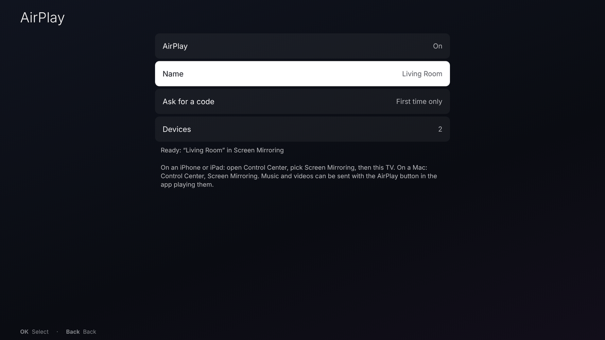
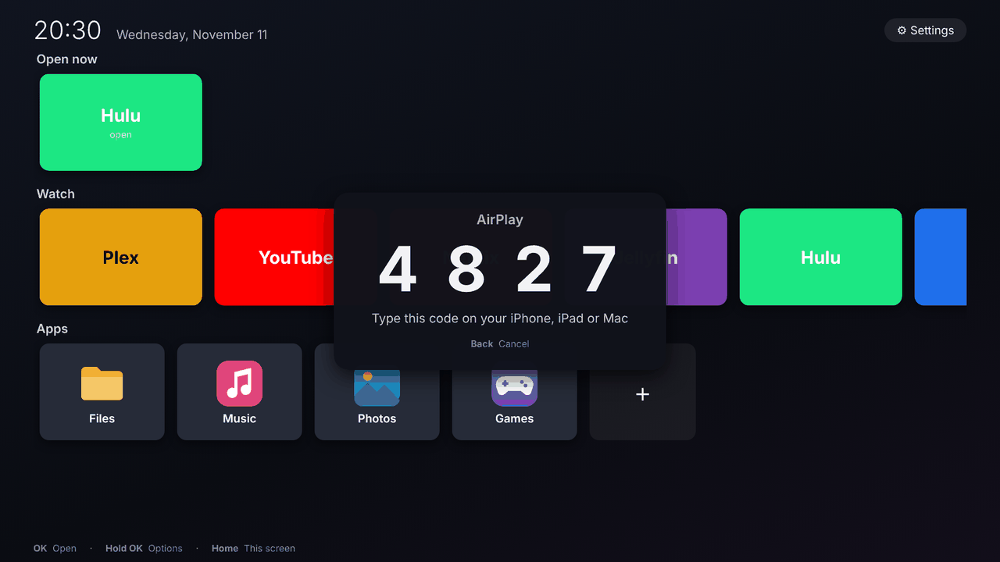
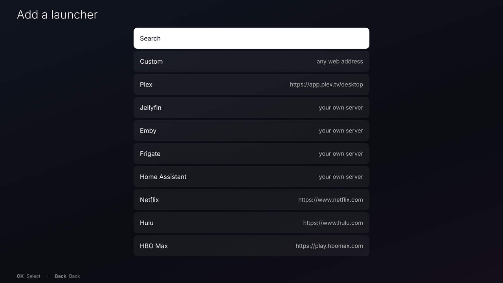
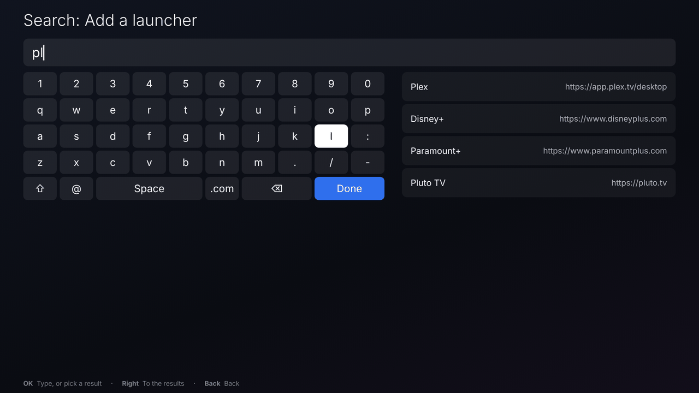
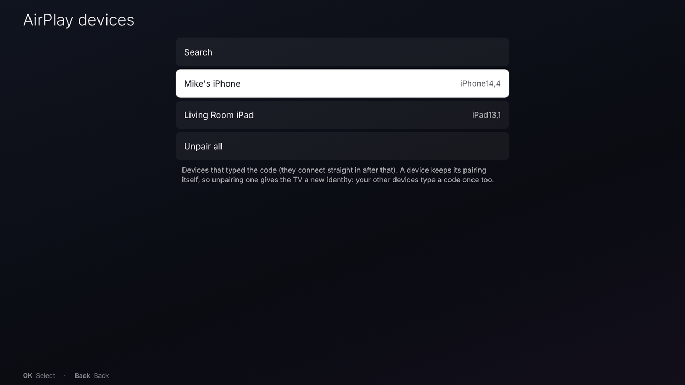
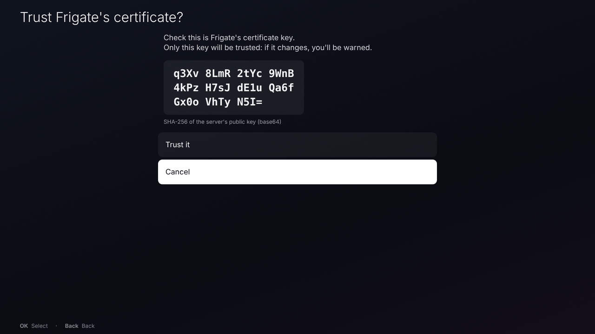

# RustTV

Part of [RustDesktop](../README.md), next to [RustTouch](RUSTTOUCH.md).

RustTV is RustTouch's sibling for a TV: a home screen for a media box,
made for a remote control. It's a separate program with its own login
session, settings (`~/.config/rusttv`) and sway config; installing it
doesn't change RustTouch.


More in [Pictures](#pictures).

## Install

The `rustdesktop` `.deb` from the Releases page has RustTV in it
(`sudo apt install ./rustdesktop_<version>_amd64.deb`; see the
[README](../README.md#install)). The `.tar.gz` there has it already built:
run `./deps.sh --tv` and `./install-rusttv.sh` in it. Or from the project
folder, built from source:

```sh
./deps.sh --tv           # sway, NetworkManager, BlueZ... and RustTV's: Chromium, UxPlay (asks for your password)
./install-rusttv.sh      # builds and installs RustTV (asks for sudo)
```

Or with `just`: `just deps-tv` and `just install-tv`. (The `.deb` only
suggests RustTV's extras - Chromium, UxPlay: `./deps.sh --tv`, or install
them yourself.) Then pick **RustTV** on
the login screen (or turn on **Settings → Autologin** in RustTV). To remove it
again: `./uninstall-rusttv.sh` (your settings stay in `~/.config/rusttv`).

It needs sway; launchers need Chromium (to start with), Chrome, Firefox or
Waterfox; AirPlay needs UxPlay. Wi-Fi, Bluetooth and sound need NetworkManager, BlueZ and
WirePlumber; Ubuntu has them all.

## The remote

| Key | What it does |
|---|---|
| Arrows | move around |
| OK (Enter) | open |
| Hold OK, or Menu | the card's options: move it, edit it, remove it, close the app |
| Back (Esc, Backspace) | go back |
| Home (or the Windows key) | back to RustTV from any app |
| Volume keys | volume (a pop-up shows how loud) |

| Play / pause, ⏮ ⏭, ⏹ (media keys) | whatever is playing |

Any remote that acts as a USB or Bluetooth keyboard works (most "air mouse"
remotes, Fire TV-style Bluetooth remotes, a wireless keyboard). A mouse
works too.

Remotes send ordinary keys, but which keys differs from one to the next.
**Settings → Remote buttons** gives any button a job: pick the job, press
the button. OK, Back, options and the arrows work in RustTV; Home, closing
the app and the volume work in every app (they become sway key bindings,
kept in `~/.config/rusttv/remote-keys.conf`). Media jobs (play / pause, back and
forward 10 seconds, previous, next, stop) work on whatever is playing.

Each launcher can also have **its own** buttons (**Edit → Remote buttons**),
working only while it's on screen - for example a button that sends Hulu
Space (pause) or Left/Right (seek), or YouTube's J/K/L.

**Settings → Pause when going home** (on to start with): pressing Home
pauses whatever is playing.

Some sites' players (Hulu's, for one) start playing again by themselves a
little while after the media buttons pause them. For those, give the
launcher's own play / pause button **Send Space** (Edit → Remote buttons):
that pauses with the site's own controls.

## AirPlay

An iPhone, iPad or Mac can show its screen on the TV, or send it a video
or music, like to an Apple TV. On the iPhone or iPad: open Control Center,
pick **Screen Mirroring**, then the TV's name (**RustTV** to start with). On a
Mac: Control Center, Screen Mirroring. A video or music app's AirPlay button
sends just what it's playing.

AirPlay is off to start with (it's a network service): turn it on in
**Settings → AirPlay**.

The first time a device connects, the TV shows a 4-digit code over
whatever is on screen; type it on the device. Each try gets a new code.
Back (or any button) puts the code away - do that if you cancel on the
device; it goes by itself when mirroring starts, or after a minute. The mirrored screen fills
the TV and shows in **Open now** as **AirPlay** while it lasts: Home goes
back to RustTV and leaves it running, OK on its card goes back to it, and
holding OK and picking **Close** stops it. When the device stops mirroring,
the TV goes back home.

**Settings → AirPlay**:

* **AirPlay** – on or off (off to start with): off, the TV doesn't show up.
* **Name** – what the TV is called in Screen Mirroring (e.g. "Living Room").
* **Ask for a code** – *First time only* (each device once, then it's
  remembered), *Every time*, or *Never* (anyone on your network can show
  their screen).
* **Restart AirPlay** – starts UxPlay again, fresh: for when a device
  connects but its screen doesn't show (what restarting RustTV did).
* **Devices** – the devices that typed the code (with *First time only*),
  with a Search row. OK on one unpairs it; **Unpair all** makes every
  device type a code again. (A device keeps its pairing itself, so
  unpairing one gives the TV a new identity: your other devices type a
  code once too, and are back on the list after.)

Each try gets its own code: UxPlay picks a new one each time a device
asks (so the codes can't all be tried one after another), and the TV
shows it. The code never goes in the log. RustTV starts UxPlay again, fresh,
whenever mirroring ends (one that's had a device sometimes gives the next
one no picture; a fresh one always does). That takes a second: connecting
again straight away may need a second try.

Only devices that typed the code are let back in without one: UxPlay keeps
them in its register (`~/.config/rusttv/airplay/register`). A device
also remembers the TV by its AirPlay device ID and key (in the same folder)
and doesn't ask again while they're the same. So unpairing gives the TV a
new ID and key - it's a new TV to every device - and **Every time** uses new
ones for each mirroring (and an empty register). The Devices list is
RustTV's own (`~/.config/rusttv/airplay.devices`), from the devices that
connect.

UxPlay runs in a sandbox (bubblewrap, `sudo apt install bubblewrap`): it
sees the system's programs, the TV's picture and sound, and of your home
folder only `~/.config/rusttv/airplay`. If bubblewrap isn't installed or
doesn't work there, RustTV runs UxPlay without it and Settings → AirPlay
says so.

If two TVs on your network have the same AirPlay name, UxPlay's log says
`dnssd_register_airplay failed with error code -65548` (a name clash):
give each its own name. (With Every time, music or a video sent with an
app's AirPlay button - not mirroring - doesn't get new ones; the next
mirroring does.)

If the TV goes black, Home brings RustTV back; hold OK on the AirPlay card
in Open now and pick Close to stop it. RustTV's log says what AirPlay did
and why (`grep -E "uxplay|airplay" /run/user/$(id -u)/rusttv/sway.log`).

It needs UxPlay, the AirPlay receiver for Linux, and GStreamer's plugins
for the video and sound (Ubuntu's uxplay doesn't bring them):
`sudo apt install bubblewrap uxplay gstreamer1.0-plugins-bad gstreamer1.0-plugins-good gstreamer1.0-libav gstreamer1.0-gl gstreamer1.0-x`
(`./deps.sh --tv` installs them all). Settings → AirPlay says what's
missing. After installing, turn AirPlay off and on again to start it
straight away. It uses Avahi to show up on the
network (Ubuntu runs `avahi-daemon` already); a firewall, if you've turned
one on, has to let it through. Its messages are in RustTV's log
(lines starting `uxplay:`).

## The home screen

* **Open now** – the apps open at the moment (only shown when there are
  some). OK switches to one; hold OK to close it.
* **Watch** – launchers: a web service (Plex, Jellyfin, Netflix, Hulu, HBO
  Max, YouTube, ...) opened full screen in a browser with no browser bars
  (kiosk mode). The **+** card adds one: pick a ready-made one, or make your
  own from any web address. Jellyfin, Emby, Frigate and Home Assistant ask for your server's address
  (e.g. `jellyfin.local:8096`).
* **Apps** – installed apps you put on the home screen (**+** to add one).

Adding a launcher or an app (and any other long list) starts with a
**Search** row: it opens the keyboard with what matches beside it,
narrowing with every letter. Right goes from the keys to the results,
**Done** to the first one, OK picks it. Typing on a real keyboard there
works too.

A launcher's card shows the service's own icon when RustTV finds a good
one on its page (its big "touch" icon or web app icons; kept in
`~/.cache/rusttv/icons`), otherwise its color and name. **Edit → Icon** turns that off; **Reload
icon** looks again. A server on your own network (a private or Tailscale
address, a `.local` name...) is trusted with a home-made certificate for
this; if its page gives no icon, a service RustTV knows (Plex, Jellyfin,
Emby, Frigate, Home Assistant, Immich, Nextcloud...) gets its icon from the
project's own site.

Alt+F4 (and Super+Q) closes the app on screen, never RustTV; if RustTV
ever stops, the session starts it again.

**Settings → Max open apps** (1 to start with, like a TV): opening one more
closes the one opened longest ago.

Browsers installed as a program, a snap or a Flatpak are all found
(Waterfox's Flatpak is `net.waterfox.waterfox`).

**Settings → Separate history** (on to start with): each launcher has a
browser profile of its own - its own sign-in and history, apart from your
everyday browsing (**Edit → Clear history** forgets one's). Off: launchers
use your browser's own profile, with your history and sign-ins (the same as
`flatpak run net.waterfox.waterfox --kiosk URL`). Those
live in `~/snap/firefox/common/rusttv/` for Ubuntu's (snap) Firefox, in
`~/.var/app/<its id>/rusttv/` for a Flatpak, otherwise in
`~/.local/share/rusttv/profiles/`. A launcher that says it's a TV (below)
always has its own: that's a browser setting, which would otherwise change
your everyday browser too.

Separate profiles turn on protected (DRM) video and turn off first-run pages
themselves; with your own profile, those are your browser's settings (if
Netflix and the like won't play, turn on Settings → "Play DRM-controlled
content" in the browser once).

### Arrow keys that jump between buttons

Sites without a TV layout (Hulu, Netflix, Max...) are desktop pages made
for a mouse. **Edit → Spatial selecting** opens a launcher in
Chromium (or Chrome) with its "spatial navigation" on: the arrows move to
the nearest button or link in that direction and OK presses it. It needs
Chromium (`sudo apt install chromium`) - sign in to the service there once.
How well it works depends on the site. Some sign-in pages (Hulu's) don't work with
it or with TV headers: hold OK on the card and pick **Open for sign-in** -
it opens as a plain page in the same browser and profile; sign in, then open
it normally (pick **Reload**).

New launchers start out this way: in Chromium, saying they're a TV, with
the arrows jumping between buttons (YouTube without the jumping - its TV
page handles the arrows itself). Change any of it under **Edit**; after
editing an open launcher, opening it asks whether to reload it.

### Servers at home (certificate warnings)

A server at home with a home-made certificate (Frigate on `https://`, a
camera, a router on an IP address) gets Chromium's "Your connection is not
private" page; Chromium forgets "Proceed" each time it restarts. **Edit →
Trust certificate** makes the launcher's Chromium trust that server's
certificate - just that one: turning it on reads the key the server shows
and shows you its fingerprint (check it's your server's), and only that
key is trusted from then on (needs `openssl`, which Ubuntu has). If the
server shows a different one later, Chromium warns as usual and RustTV
says the certificate changed: turn Trust certificate off and on again if
you changed it yourself. To see your server's key fingerprint, to compare
(on the server, with its certificate file):

```sh
openssl x509 -in cert.pem -pubkey -noout | openssl pkey -pubin -outform der \
  | openssl dgst -sha256 -binary | openssl base64
```

A launcher's address has to be `http://` or `https://`. Firefox and Waterfox
remember "Accept the risk and continue" by themselves.

### TV layouts

**Edit → Send TV headers** makes the launcher's browser tell sites it's a TV
(a games-console browser's name). Sites with a TV layout then show it -
YouTube's (`youtube.com/tv`, which the ready-made YouTube launcher uses) is
made for a remote: arrows and OK. Most streaming sites (Netflix, Hulu, Max,
Disney+) have no TV layout on the web, and may refuse a browser that says
it's a TV - leave it off for them.

For the services with their own TV apps for Linux, those beat any browser
(add them under **Apps** once installed):

* Plex: **Plex HTPC** (`flatpak install flathub tv.plex.PlexHTPC`)
* Jellyfin: **Jellyfin Media Player** (on Flathub; TV mode in its settings)
* Kodi (`sudo apt install kodi`), which has add-ons for Jellyfin, Plex and YouTube

With protected (DRM) video on, Netflix, Hulu, HBO Max and Disney+ play
(Firefox downloads the Widevine module the first time). Like any Linux
browser, those services stream at up to 720p-1080p.

## Settings

* **Launchers**, **Apps** – add, edit, remove (to move one, hold OK on its
  card: Move left / Move right; or hold OK on a
  card on the home screen).
* **Max open apps**, **Remote buttons** – see above.
* **Default browser** – for new launchers: Chromium (to start with),
  Chrome, Firefox or Waterfox. **Separate history** – see above.
* **AirPlay** – see [AirPlay](#airplay).
* **Wi-Fi**, **Bluetooth**, **Sound** – networks (passwords typed with the
  remote), Bluetooth devices (remotes, game pads, headphones, speakers),
  the volume and which output/input to use. Need NetworkManager, BlueZ
  and WirePlumber (Ubuntu has them).
* **Screens** – with more than one, which one RustTV is on; the others
  show a copy (needs `wl-mirror`); each screen's resolution.
* **Scale** – for 4K TVs pick 200%.
* **Autologin** – the TV starts straight into RustTV with no
  password, like a TV. Works with GDM (Ubuntu), LightDM and SDDM. A small
  helper (`/usr/local/libexec/rusttv-autologin`) changes the login screen's
  settings, for your own account only. Turning it **on** takes away the
  login password, so it asks for an administrator's password (typed on
  RustTV's keyboard, given to sudo). Turning it **off** needs none (a polkit
  rule for the person at the TV). Anyone who turns the TV on then gets your
  account - see [Security](#security).
* **Accent color**, **Background** – the focus outline and highlights;
  dark, black, an accent glow, or a picture (from `~/Pictures` or the
  system's wallpapers, dimmed).
* **Battery** (only with one) – its level at the top of the home screen,
  and a warning over everything when it runs low.
* **Auto suspend** – after 15 minutes to 4 hours with nothing going on
  (a video playing keeps it awake: browsers ask the screen to stay on).
  Needs swayidle (`sudo apt install swayidle`).
* **Updates** – checks the system (apt), snaps and Flatpaks, and installs
  them all (apt `upgrade --with-new-pkgs`, `snap refresh`, `flatpak
  update`). A helper (`/usr/local/libexec/rusttv-update`) does it with a
  polkit rule for the person at the TV, without a password: it only updates
  what's installed, and never removes anything.
  Its log: `/var/log/rusttv-update.log`.
* **Power button** – what the remote's power button does: *Suspend* (to
  start with), *Show the power menu*, *Shut down*, or *Nothing*. (RustTV
  keeps the button from the system, which would shut down, while it runs.)
* **Power** – suspend, restart, shut down, log out.

Typing (names, web addresses) uses an on-screen keyboard you move through
with the arrows; a real keyboard types straight in.

In apps too: when a text box on a web page gets the focus, RustTV's
keyboard comes up at the bottom - arrows and OK to type, Back to put it
away, and a real keyboard types straight in (the on-screen one goes away).
Turn it off with **Settings → Keyboard in apps**; give a remote button
"Show the keyboard" to bring it back in the same box.

## Your own additions

* `~/.config/rusttv/sway.conf` – extra sway config (included at the end).
* `~/.config/rusttv/env` – environment variables for the session.
* `~/.config/rusttv/rusttv.json` – RustTV's settings (launchers, apps).
* `rusttv --do JOB` – for your own key bindings: `home`, `settings`, `close`,
  `keyboard`, `volume-up`, `volume-down`, `mute`, `play-pause`, `seek-back`,
  `seek-forward`, `previous`, `next`, `stop`.

## Copying your settings to another box

Everything you set up (launchers, apps, remote buttons, the look, AirPlay's
name and code setting...) is in `~/.config/rusttv/rusttv.json`. Copy that
folder to the other box, leaving out the AirPlay identity (each TV should
have its own), then log out and back in there:

```sh
rsync -av --exclude 'airplay*' ~/.config/rusttv/ OTHER-BOX:.config/rusttv/
```

It works between different machines: screens the other box doesn't have
are left alone (it picks its screen and resolution by itself - set
**Screens** and **Scale** there if you want), apps it hasn't got installed
don't show, and a wallpaper picture that isn't there falls back to the
background colour. Copy the picture too if you use one. Not copied:
**Autologin** (a system setting - turn it on there), sign-ins inside the
launchers (`~/.local/share/rusttv/profiles/`: copying that folder too
may carry them over, but sites often ask again on a new machine).

## Security

RustTV is made for the person holding the remote: it has no lock screen,
and its Apps row can open any installed app (a terminal too). So whoever
has the remote has the account RustTV runs in. Run RustTV in an account
of its own, meant for the TV - not an administrator (not in the `sudo`
group), with nothing private in it - above all with Autologin on.

What it does to keep the rest safe:

* **AirPlay** is off to start with; on, a device types a code (a new one
  each try) and only devices that did are let back in; UxPlay runs in a
  sandbox that can't see your home folder.
* **Autologin** takes an administrator's password to turn on.
* **Updates** need no password, but only update what's installed and never
  remove anything.
* **Trust certificate** trusts the one key you saw, not whatever the server
  shows later.
* Launcher addresses are `http://` or `https://` only; downloaded icons
  are only opened if they're PNG, JPEG, ICO or SVG (checked before any
  decoder sees them). Icons from a server on your own network are fetched
  even with a home-made certificate (they're only pictures).

## Pictures

| Home screen | Settings |
|---|---|
|  |  |
| **Wi-Fi** | **Sound** |
|  |  |
| **The keyboard in apps** (over a web page's sign-in) | **AirPlay** |
|  |  |
| **The AirPlay code** (a device connecting for the first time) | **Add a launcher** |
|  |  |
| **Search** (the keyboard, and what matches) | **AirPlay devices** |
|  |  |
| **Trust certificate** (the key to check) | |
|  | |

These are mock-ups drawn from RustTV's own style sheet and layout (the same
colours, sizes and text), with the launchers' plain colour cards rather than
the services' icons. To replace them with real ones, on the TV
(grim is in `./deps.sh`):
`grim docs/screenshots/rusttv/home.png`, from a terminal or over SSH
(`SWAYSOCK=$(ls /run/user/$(id -u)/sway-ipc.*) WAYLAND_DISPLAY=wayland-1 grim ...`).

## Not there yet

* HDMI-CEC (the TV's own remote over HDMI) needs a CEC adapter and a
  key-mapping tool such as `cec-client`; RustTV just sees the keys.
* The web services' own "TV" layouts (YouTube's leanback page, for one)
  only show for TV browsers; they show their normal web pages.
