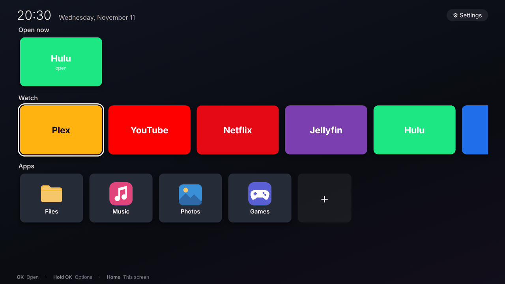
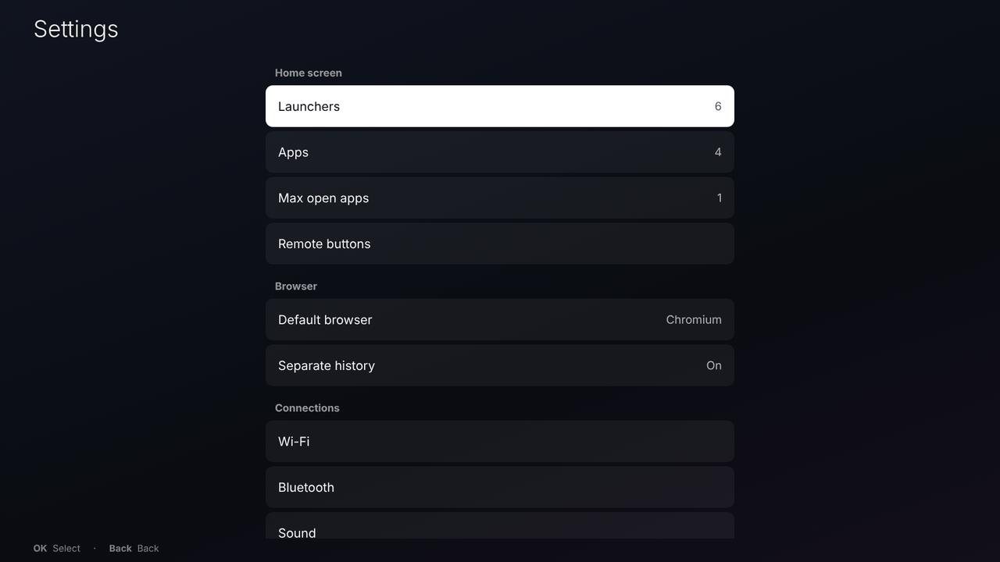
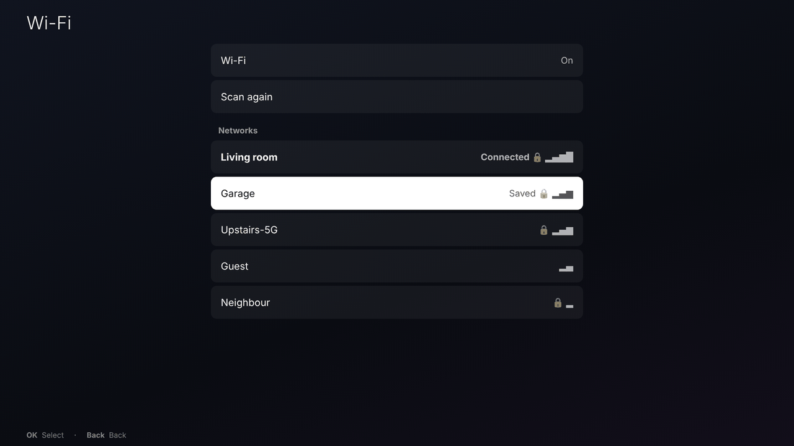
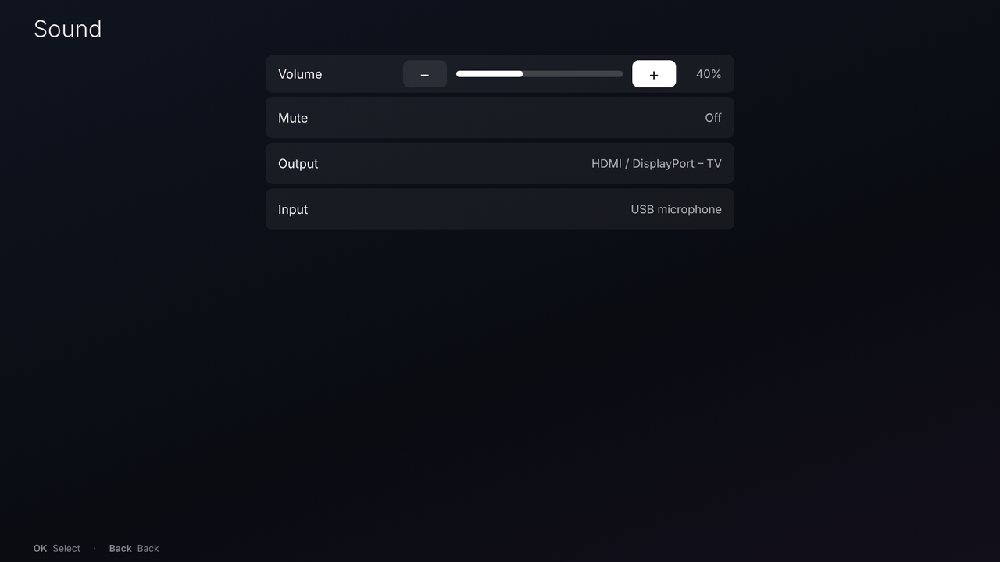
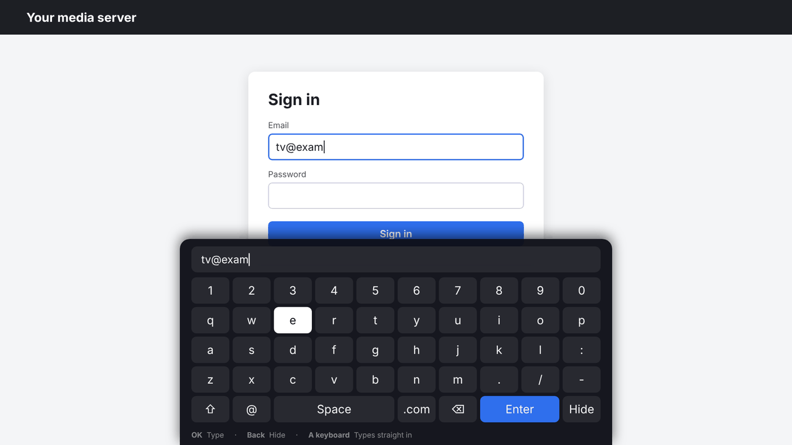

# RustTV

Part of [RustDesktop](../README.md), next to [RustTouch](RUSTTOUCH.md).

RustTV is RustTouch's sibling for a TV: a home screen for a media box,
made for a remote control. It's a separate program with its own login
session, settings (`~/.config/rusttv`) and sway config; installing it
doesn't change RustTouch.



More in [Pictures](#pictures).

## Install

The `rustdesktop` `.deb` from the Releases page has RustTV in it
(`sudo apt install ./rustdesktop_<version>_amd64.deb`; see the
[README](../README.md#install)). The `.tar.gz` there has it already built:
run `./deps.sh` and `./install-rusttv.sh` in it. Or from the project folder,
built from source:

```sh
./deps.sh                # sway, Chromium, NetworkManager, BlueZ... (asks for your password)
./install-rusttv.sh      # builds and installs RustTV (asks for sudo)
```

Or with `just`: `just deps` and `just install-tv`. Then pick **RustTV** on
the login screen (or turn on **Settings → Autologin** in RustTV). To remove it
again: `./uninstall-rusttv.sh` (your settings stay in `~/.config/rusttv`).

It needs sway; launchers need Chromium (to start with), Chrome, Firefox or
Waterfox. Wi-Fi, Bluetooth and sound need NetworkManager, BlueZ and
WirePlumber; Ubuntu has them all.

## The remote

| Key | What it does |
|---|---|
| Arrows | move around |
| OK (Enter) | open |
| Hold OK, or Menu | the card's options: move it, edit it, remove it, close the app |
| Back (Esc, Backspace) | go back |
| Home (or the Windows key) | back to RustTV from any app |
| Volume keys | volume (a pop-up shows how loud) |

| Play / pause, ⏮ ⏭, ⏹ (media keys) | whatever is playing |

Any remote that acts as a USB or Bluetooth keyboard works (most "air mouse"
remotes, Fire TV-style Bluetooth remotes, a wireless keyboard). A mouse
works too.

Remotes send ordinary keys, but which keys differs from one to the next.
**Settings → Remote buttons** gives any button a job: pick the job, press
the button. OK, Back, options and the arrows work in RustTV; Home, closing
the app and the volume work in every app (they become sway key bindings,
kept in `~/.config/rusttv/remote-keys.conf`). Media jobs (play / pause, back and
forward 10 seconds, previous, next, stop) work on whatever is playing.

Each launcher can also have **its own** buttons (**Edit → Remote buttons**),
working only while it's on screen - for example a button that sends Hulu
Space (pause) or Left/Right (seek), or YouTube's J/K/L.

**Settings → Pause when going home** (on to start with): pressing Home
pauses whatever is playing.

Some sites' players (Hulu's, for one) start playing again by themselves a
little while after the media buttons pause them. For those, give the
launcher's own play / pause button **Send Space** (Edit → Remote buttons):
that pauses with the site's own controls.

## The home screen

* **Open now** – the apps open at the moment (only shown when there are
  some). OK switches to one; hold OK to close it.
* **Watch** – launchers: a web service (Plex, Jellyfin, Netflix, Hulu, HBO
  Max, YouTube, ...) opened full screen in a browser with no browser bars
  (kiosk mode). The **+** card adds one: pick a ready-made one, or make your
  own from any web address. Jellyfin, Emby, Frigate and Home Assistant ask for your server's address
  (e.g. `jellyfin.local:8096`).
* **Apps** – installed apps you put on the home screen (**+** to add one).

A launcher's card shows the service's own icon when RustTV finds a good
one on its page (its big "touch" icon or web app icons; kept in
`~/.cache/rusttv/icons`), otherwise its color and name. **Edit → Icon** turns that off; **Reload
icon** looks again.

**Settings → Max open apps** (1 to start with, like a TV): opening one more
closes the one opened longest ago.

Browsers installed as a program, a snap or a Flatpak are all found
(Waterfox's Flatpak is `net.waterfox.waterfox`).

**Settings → Separate history** (on to start with): each launcher has a
browser profile of its own - its own sign-in and history, apart from your
everyday browsing (**Edit → Clear history** forgets one's). Off: launchers
use your browser's own profile, with your history and sign-ins (the same as
`flatpak run net.waterfox.waterfox --kiosk URL`). Those
live in `~/snap/firefox/common/rusttv/` for Ubuntu's (snap) Firefox, in
`~/.var/app/<its id>/rusttv/` for a Flatpak, otherwise in
`~/.local/share/rusttv/profiles/`. A launcher that says it's a TV (below)
always has its own: that's a browser setting, which would otherwise change
your everyday browser too.

Separate profiles turn on protected (DRM) video and turn off first-run pages
themselves; with your own profile, those are your browser's settings (if
Netflix and the like won't play, turn on Settings → "Play DRM-controlled
content" in the browser once).

### Arrow keys that jump between buttons

Sites without a TV layout (Hulu, Netflix, Max...) are desktop pages made
for a mouse. **Edit → Spatial selecting** opens a launcher in
Chromium (or Chrome) with its "spatial navigation" on: the arrows move to
the nearest button or link in that direction and OK presses it. It needs
Chromium (`sudo apt install chromium`) - sign in to the service there once.
How well it works depends on the site. Some sign-in pages (Hulu's) don't work with
it or with TV headers: hold OK on the card and pick **Open for sign-in** -
it opens as a plain page in the same browser and profile; sign in, then open
it normally (pick **Reload**).

New launchers start out this way: in Chromium, saying they're a TV, with
the arrows jumping between buttons (YouTube without the jumping - its TV
page handles the arrows itself). Change any of it under **Edit**; after
editing an open launcher, opening it asks whether to reload it.

### Servers at home (certificate warnings)

A server at home with a home-made certificate (Frigate on `https://`, a
camera, a router on an IP address) gets Chromium's "Your connection is not
private" page; Chromium forgets "Proceed" each time it restarts. **Edit →
Trust certificate** makes the launcher's Chromium trust that server's
certificate - just that one (by its key's fingerprint, read when the
launcher opens; needs `openssl`, which Ubuntu has). Firefox and Waterfox
remember "Accept the risk and continue" by themselves.

### TV layouts

**Edit → Send TV headers** makes the launcher's browser tell sites it's a TV
(a games-console browser's name). Sites with a TV layout then show it -
YouTube's (`youtube.com/tv`, which the ready-made YouTube launcher uses) is
made for a remote: arrows and OK. Most streaming sites (Netflix, Hulu, Max,
Disney+) have no TV layout on the web, and may refuse a browser that says
it's a TV - leave it off for them.

For the services with their own TV apps for Linux, those beat any browser
(add them under **Apps** once installed):

* Plex: **Plex HTPC** (`flatpak install flathub tv.plex.PlexHTPC`)
* Jellyfin: **Jellyfin Media Player** (on Flathub; TV mode in its settings)
* Kodi (`sudo apt install kodi`), which has add-ons for Jellyfin, Plex and YouTube

With protected (DRM) video on, Netflix, Hulu, HBO Max and Disney+ play
(Firefox downloads the Widevine module the first time). Like any Linux
browser, those services stream at up to 720p-1080p.

## Settings

* **Launchers**, **Apps** – add, edit, reorder, remove (or hold OK on a
  card on the home screen).
* **Max open apps**, **Remote buttons** – see above.
* **Default browser** – for new launchers: Chromium (to start with),
  Chrome, Firefox or Waterfox. **Separate history** – see above.
* **Wi-Fi**, **Bluetooth**, **Sound** – networks (passwords typed with the
  remote), Bluetooth devices (remotes, game pads, headphones, speakers),
  the volume and which output/input to use. Need NetworkManager, BlueZ
  and WirePlumber (Ubuntu has them).
* **Screens** – with more than one, which one RustTV is on; the others
  show a copy (needs `wl-mirror`); each screen's resolution.
* **Scale** – for 4K TVs pick 200%.
* **Autologin** – the TV starts straight into RustTV with no
  password, like a TV. Works with GDM (Ubuntu), LightDM and SDDM. A small
  helper (`/usr/local/libexec/rusttv-autologin`) changes the login screen's
  settings; a polkit rule lets the person at the TV do that for their own
  account only, without a password (there is no password prompt to type
  into with a remote). Anyone who turns the TV on then gets your account, so use
  an account meant for the TV.
* **Accent color**, **Background** – the focus outline and highlights;
  dark, black, an accent glow, or a picture (from `~/Pictures` or the
  system's wallpapers, dimmed).
* **Battery** (only with one) – its level at the top of the home screen,
  and a warning over everything when it runs low.
* **Auto suspend** – after 15 minutes to 4 hours with nothing going on
  (a video playing keeps it awake: browsers ask the screen to stay on).
  Needs swayidle (`sudo apt install swayidle`).
* **Updates** – checks the system (apt), snaps and Flatpaks, and installs
  them all (apt `dist-upgrade`, `snap refresh`, `flatpak update`). Like
  Autologin, a helper (`/usr/local/libexec/rusttv-update`) does it with a
  polkit rule for the person at the TV: it only updates what's installed.
  Its log: `/var/log/rusttv-update.log`.
* **Power** – suspend, restart, shut down, log out.

Typing (names, web addresses) uses an on-screen keyboard you move through
with the arrows; a real keyboard types straight in.

In apps too: when a text box on a web page gets the focus, RustTV's
keyboard comes up at the bottom - arrows and OK to type, Back to put it
away, and a real keyboard types straight in (the on-screen one goes away).
Turn it off with **Settings → Keyboard in apps**; give a remote button
"Show the keyboard" to bring it back in the same box.

## Your own additions

* `~/.config/rusttv/sway.conf` – extra sway config (included at the end).
* `~/.config/rusttv/env` – environment variables for the session.
* `~/.config/rusttv/rusttv.json` – RustTV's settings (launchers, apps).
* `rusttv --do JOB` – for your own key bindings: `home`, `settings`, `close`,
  `keyboard`, `volume-up`, `volume-down`, `mute`, `play-pause`, `seek-back`,
  `seek-forward`, `previous`, `next`, `stop`.

## Pictures

| Home screen | Settings |
|---|---|
|  |  |
| **Wi-Fi** | **Sound** |
|  |  |
| **The keyboard in apps** (over a web page's sign-in) | |
|  | |

These are mock-ups drawn from RustTV's own style sheet and layout (the same
colours, sizes and text), with the launchers' plain colour cards rather than
the services' icons. To replace them with real ones, on the TV
(grim is in `./deps.sh`):
`grim docs/screenshots/rusttv/home.png`, from a terminal or over SSH
(`SWAYSOCK=$(ls /run/user/$(id -u)/sway-ipc.*) WAYLAND_DISPLAY=wayland-1 grim ...`).

## Not there yet

* HDMI-CEC (the TV's own remote over HDMI) needs a CEC adapter and a
  key-mapping tool such as `cec-client`; RustTV just sees the keys.
* The web services' own "TV" layouts (YouTube's leanback page, for one)
  only show for TV browsers; they show their normal web pages.
